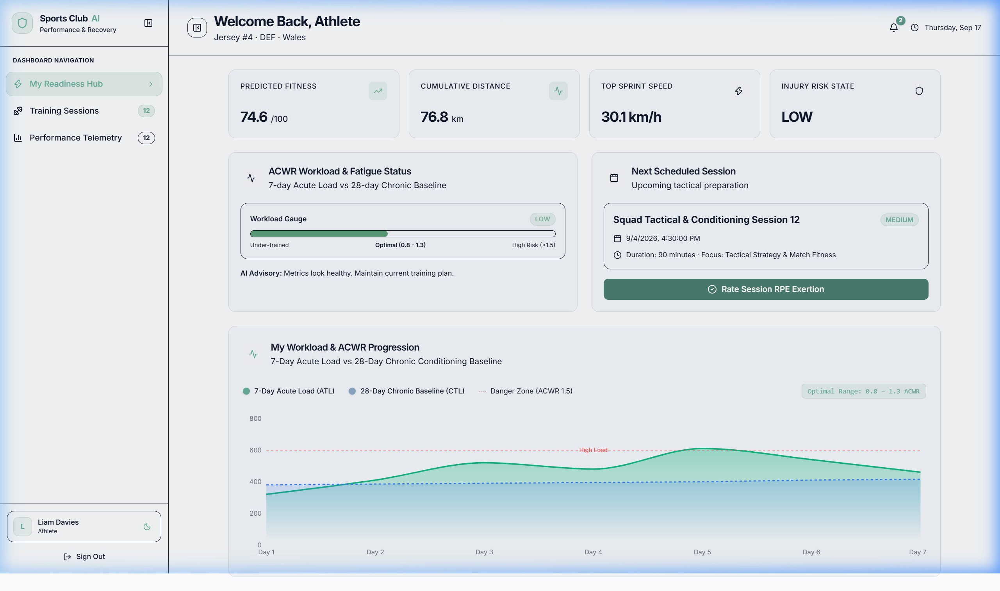
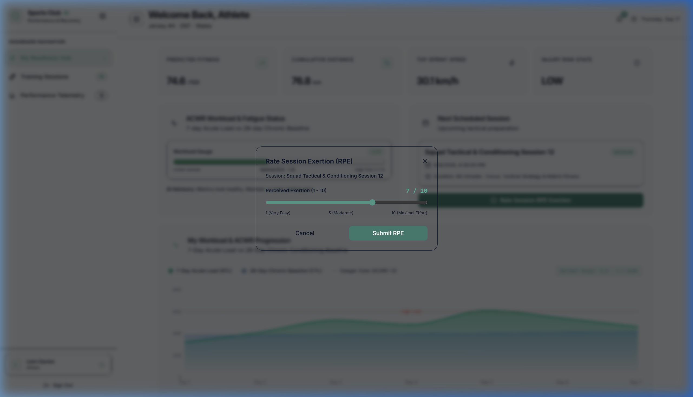
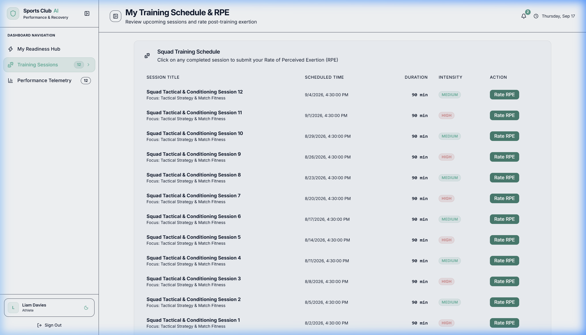
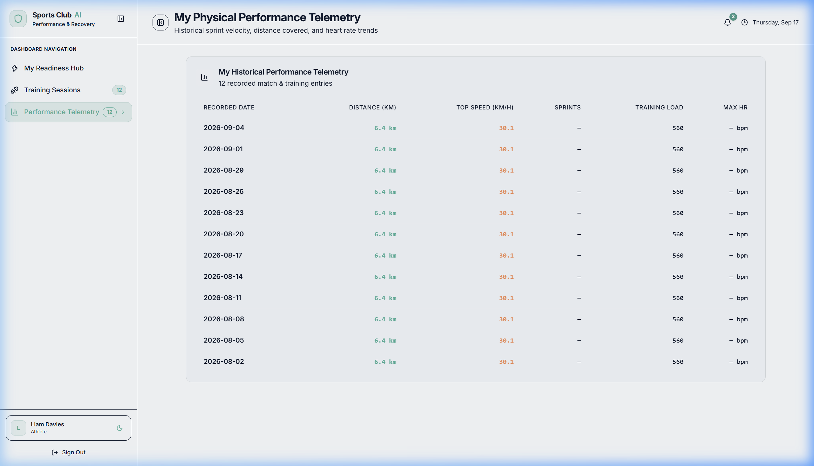

# ⚽ Sports Club AI — Predictive Management & Athlete Injury Prevention System

<div align="center">

[](https://fastapi.tiangolo.com)
[](https://react.dev/)
[](https://www.typescriptlang.org/)
[](https://www.python.org/)
[](https://scikit-learn.org/)
[](https://tailwindcss.com/)
[](https://www.sqlalchemy.org/)

**An enterprise sports management and predictive analytics SaaS platform designed to eliminate preventable soft-tissue injuries and centralize modern athletic club operations.**

[Key Features](#-key-features) • [Architecture](#-system-architecture) • [Quick Start](#-quick-start-guide) • [Demo Accounts](#-pre-seeded-demo-accounts) • [Documentation](#-project-documentation)

</div>

---

## 📖 Overview

In modern athletics, non-contact soft-tissue injuries (hamstring tears, calf strains, groin pulls) cost professional and academy sports organizations millions of dollars in medical rehabilitation, wasted wages, and lost trophies. 

Traditional clubs still manage daily operations across disconnected tools: coaches track drills in paper notebooks, attendance is managed in WhatsApp groups, and medical records are stored in localized clinic files. Because data is siloed, coaching staff cannot identify when an athlete enters the **acute fatigue spike zone**.

**Sports Club AI** resolves this fragmentation by establishing an end-to-end data pipeline:
1. **Athlete Exertion Tracking**: Athletes report post-training Rate of Perceived Exertion (RPE 1–10).
2. **Real-time ACWR Mathematics**: Calculates Acute Training Load (7-day ATL) against Chronic Baseline (28-day CTL).
3. **Machine Learning Intelligence**: Scikit-learn Logistic Regression pipelines predict injury probability ($89.63\%$ accuracy) and forecast continuous match readiness scores.
4. **Physiotherapy & Return-to-Play**: Tracks clinical injury diagnosis with a 1-click clinical clearance workflow.
5. **Role-Tailored Portals**: Custom workspaces for Administrators, Coaches, Physiotherapists, Operational Staff, and Athletes.

---

## 🌟 Key Features

* 🔮 **Predictive Injury Management**: Automatically calculates rolling Acute-to-Chronic Workload Ratios (ACWR). Flags acute workload spikes ($>1.5\text{ ACWR}$) with red risk indicators before muscular failure occurs.
* 📊 **Interactive Recharts Workload Analytics**: Live visual telemetry curves comparing 7-Day Acute Load ($ATL$) against 28-Day Chronic Baseline ($CTL$) with optimal sweet-spot guidance ($0.8\text{--}1.3$).
* 🔐 **Google Single Sign-On with Admin Approval**: Secure Google OAuth 2.0 login. Unregistered Google users are placed in a `Pending Approval` state until verified by a Club Administrator.
* 👑 **Administrator Governance Hub**: Complete user directory, status toggling (Active vs. Suspended), membership subscription billing, and 1-Click offline CSV Audit Exporters.
* 🏆 **Head Coach Squad Hub**: Tactical training scheduler, squad position filtering (`GK`, `DEF`, `MID`, `FWD`), match fixture tracking, and live 1-click **Retrain ML Model** controls.
* 🩺 **Physiotherapy & Return-to-Play**: Full medical injury logging (severity grading, anatomical body part, cause) with a **1-Click Return-to-Play (RTP)** clearance workflow.
* ⚡ **Athlete Self-Service Portal**: Mobile-responsive dashboard featuring a live Readiness Gauge, personal training calendar, and an interactive **Rate Session RPE** slider modal.
* 🎨 **Glassmorphism UI & Theme Engine**: Modern responsive design tokens supporting zero-flicker **Dark Mode** and **Light Mode** switching.
* 📁 **Collapsible Vertical Sidebar**: 280px expanded and 72px icon-only mini-rail navigation with `localStorage` preference caching.

---

## 📸 Platform Preview

| Athlete Readiness & Workload Hub | Post-Session RPE Rating Modal |
| :---: | :---: |
|  |  |

| Tactical Training Schedule | Physical Telemetry & Heart Rate Logs |
| :---: | :---: |
|  |  |

---

## 🏗️ System Architecture

```
┌─────────────────────────────────────────────────────────────────────────────┐
│                       CLIENT LAYER: React 19 + TypeScript                   │
│  - Vite 8 Bundler       - React Router DOM v6        - Recharts Visuals     │
│  - Tailwind CSS Tokens  - Lucide React Icons         - Google OAuth 2.0     │
└──────────────────────────────────────┬──────────────────────────────────────┘
                                       │ HTTPS / REST (JWT Bearer Auth)
┌──────────────────────────────────────▼──────────────────────────────────────┐
│                    APPLICATION LAYER: FastAPI (Python 3.11)                 │
│  - OAuth2 Password Bearer & JWT Security      - Pydantic v2 Schema Engine   │
│  - SQLAlchemy 2.0 Declarative ORM             - RBAC Permission Guards      │
│  - Streaming CSV Reports Engine               - Background Tasks            │
└──────────────────────────┬───────────────────────────────┬──────────────────┘
                           │                               │
┌──────────────────────────▼───────────┐       ┌───────────▼──────────────────┐
│      PERSISTENCE TIER: Database      │       │     PREDICTIVE ML SUBSYSTEM   │
│  - SQLite (Local Dev: sportsclub.db) │       │  - scikit-learn Pipelines    │
│  - PostgreSQL 16 (Docker Production) │       │  - StandardScaler + Models   │
│  - Alembic Schema Version Migrations │       │  - .joblib Serialized Bundles│
└──────────────────────────────────────┘       └──────────────────────────────┘
```

---

## 👥 Role-Based Access Control (RBAC) Matrix

The system enforces strict permission scoping across 5 distinct roles:

| Action / Permission | Admin | Coach | Athlete | Physio | Staff |
| :--- | :---: | :---: | :---: | :---: | :---: |
| **Manage Users & Accept Registrations** | ✅ Full | ❌ | ❌ | ❌ | ❌ |
| **Memberships & Billing Tiers** | ✅ Full | 🔒 Read | 🔒 Self Plan | 🔒 Read | 🔒 Read |
| **1-Click CSV Audit Reports** | ✅ Full | 🔒 Read | ❌ | 🔒 Read | 🔒 Read |
| **Squad Telemetry & Performance Logs** | ✅ Full | ✅ Write | 🔒 Self Only | ✅ Read | ✅ Read |
| **Schedule Training Drills** | ✅ Full | ✅ Write | 🔒 Read Assigned | 🔒 Read | 🔒 Read |
| **Submit Attendance & Rate RPE (1-10)** | ✅ Full | ✅ Write | 🔒 Submit Self | 🔒 Read | ✅ Write |
| **Log Injuries & 1-Click Return-to-Play**| ✅ Full | 🔒 Read | 🔒 Self History | ✅ Full Write | 🔒 Read |
| **Retrain Machine Learning Engine** | ✅ Full | ✅ Execute | ❌ | ❌ | ❌ |
| **Grounds & Equipment Inventory** | ✅ Full | 🔒 Read | 🔒 Read | 🔒 Read | ✅ Full Write |

---

## 🧮 The Scientific & Machine Learning Core

### 1. Training Load Formula (Arbitrary Units - AU)
$$\text{Session Load (AU)} = \text{Session Duration (min)} \times \text{RPE Rating (1--10)}$$

### 2. Acute-to-Chronic Workload Ratio (ACWR)
$$\text{ATL}_7 = \frac{1}{7} \sum_{i=1}^{7} \text{Load}_i, \quad \text{CTL}_{28} = \frac{1}{28} \sum_{j=1}^{28} \text{Load}_j, \quad \text{ACWR} = \frac{\text{ATL}_7}{\text{CTL}_{28} + 10^{-5}}$$

* **$< 0.8$ (Under-training)**: Decreased physical conditioning; risk of injury upon match intensity resumption.
* **$0.8\text{--}1.3$ (The Sweet Spot)**: Optimal conditioning zone; maximum fitness gains with minimized soft-tissue injury risk.
* **$> 1.5$ (The Danger Zone)**: High acute fatigue spike; statistical probability of muscle injury increases by $2\times\text{--}4\times$.

### 3. Machine Learning Models
* **Injury Risk Classifier**: `LogisticRegression(class_weight="balanced")` fitted over 18 workload attributes. **ROC-AUC: 83.27%**, **Accuracy: 89.63%**.
* **Match Readiness Regressor**: `GradientBoostingRegressor(n_estimators=100)` predicting continuous match readiness ($20\text{--}100$).
* **Heuristic Engine**: Mathematical fail-safe guaranteeing zero downtime if ML pipelines are uninitialized.

---

## 🚀 Quick Start Guide

### Prerequisites
* **Python**: 3.11 or higher
* **Node.js**: 18.x or 20.x
* **Package Managers**: `pip` and `npm`

---

### Step 1: Backend Setup (FastAPI)

```bash
# 1. Enter backend directory
cd backend

# 2. Create virtual environment
python -m venv .venv

# 3. Activate virtual environment
# Windows (PowerShell):
.venv\Scripts\Activate.ps1
# Linux / macOS:
# source .venv/bin/activate

# 4. Install dependencies
pip install -r requirements.txt

# 5. Populate database with mock squad, demo accounts & pre-trained ML models
python seed.py

# 6. Launch FastAPI server (Port 8000)
uvicorn app.main:app --host 127.0.0.1 --port 8000 --reload
```
* **API Home**: [http://127.0.0.1:8000](http://127.0.0.1:8000)
* **Interactive Swagger Documentation**: [http://127.0.0.1:8000/docs](http://127.0.0.1:8000/docs)

---

### Step 2: Frontend Setup (React + Vite)

Open a second terminal:

```bash
# 1. Enter frontend directory
cd frontend

# 2. Install Node dependencies
npm install

# 3. Launch Vite dev server (Port 5173)
npm run dev
```
* **Frontend Web App**: [http://localhost:5173](http://localhost:5173)

---

## 🔑 Pre-Seeded Demo Accounts

The login page includes interactive **Quick Demo Tiles** that autofill credentials with 1 click:

| Role | Email | Password | Primary Portal Route |
| :--- | :--- | :--- | :--- |
| 👑 **Administrator** | `admin@example.com` | `admin123` | `/dashboard/admin` |
| 🏆 **Head Coach** | `coach@example.com` | `coach123` | `/dashboard/coach` |
| 🩺 **Physiotherapist** | `physio@example.com` | `physio123` | `/dashboard/staff` |
| ⚡ **Club Athlete** | `athlete@example.com` | `athlete123` | `/dashboard/athlete` |

---

## 🧪 Testing Suite

### Backend Pytest Suite
```bash
cd backend
.venv\Scripts\pytest
```
*Executes unit and integration tests including Google OAuth JIT provisioning and CSV streaming validation.*

### Frontend Vitest Suite & Production Build
```bash
cd frontend
# Run unit tests
npm run test

# Run production build and TypeScript type-checking
npm run build
```

---

## 📚 Project Documentation

Detailed system specifications and manuals are available in the repository:
* 📄 **[Master Technical Manual](docs/FULL_PROJECT_DOCUMENTATION.md)**: 1,000+ line technical manual covering all models, algorithms, and workflows.
* 📄 **[Architecture Blueprint](ARCHITECTURE.md)**: Structural decomposition and state management patterns.
* 📄 **[User Manual & Platform Guide](docs/USER_MANUAL.md)**: Step-by-step role walkthroughs.
* 📄 **[Senior Project Thesis Document](docs/Senior_Project_Documentation.md)**: Academic graduation report.

---

## 📄 License & Attribution

Developed as a modern predictive sports engineering system.  
*Sports Club AI Platform · Predictive Management System v1.0 SaaS*
